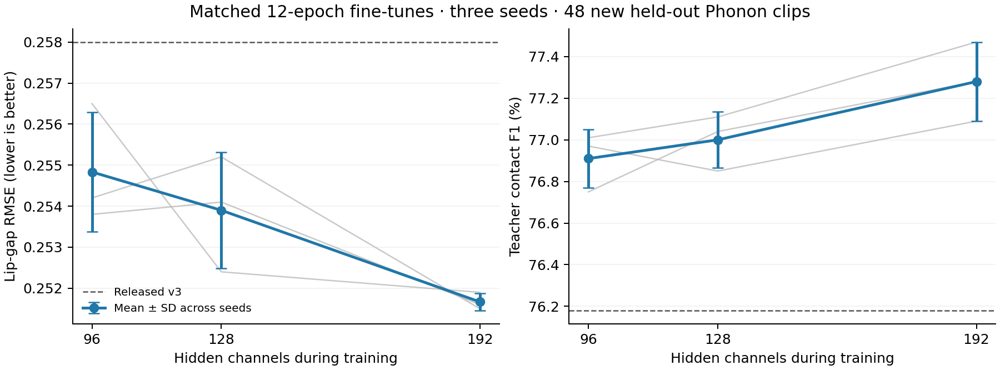

# Compact v3 width follow-up: longer training and matched seeds

Study started 2026-11-07. The live demo and released v3 remain unchanged.

## Frozen design

Compare widths 96, 128 and 192, each trained from released v3 for 12 epochs at
seeds 37, 73 and 101. This doubles the earlier six-epoch budget and adds two
independent seed pairs. Each run has 972 optimizer updates and 64 windows per
update: 48 from the frozen v3 corpus (including its earlier 96 extra clips) and
16 from legacy v1/v2 replay. The newer 61-clip data arm is excluded so the width
comparison changes only width. Losses, teacher references, normalization and
checkpoint-selection score match the first ablation study.

Width expansion preserves the initial function apart from seeded 1e-5 parameter
noise. A separate RNG preserves window and replay order within each seed pair.
The 12-epoch cosine schedule starts at 0.00006 and ends at 0.000006. It is a new
12-epoch run, not a restart of the six-epoch optimizer with an undocumented LR
reset. Epoch-zero selection remains allowed. Each epoch saves a recoverable
training-state snapshot; selected checkpoints use validation scores only.

Training runs on CPU with up to three concurrent processes, each with six PyTorch
threads. A temporary third process completed the width-96 seed-101 fit at lower OS
priority. Its partial width-128 run was stopped to reduce contention; the main
driver reruns that configuration from v3 for the full budget. Only complete
runs enter the analysis, and the completed identical width-96 fit is reused.
Timing comparisons run only after training finishes. Scripts are frozen per study,
and record their hash, initial-model hash, seed and hyperparameters. Feature
caches fingerprint audio, labels and split manifests; atomic cache writes and
in-process reuse prevent stale or partially written input features.

## Fresh confirmation set

There are 48 newly written prompts, eight each in conversation, `/m/` closures,
`/b/` closures, `/p/` closures, connected speech, and pauses. None has exact
normalized transcript overlap with any historical train/dev/test split or the
61-clip extra-data experiment. The prompt manifest was frozen before evaluating
any follow-up model:

`c782525fc3c5d688c7d1082512bdf6f1d289e1cb4f22658d3babf4c19285d65f`

These are new transcripts from the same Phonon Easton synthesis distribution;
they do not test unseen speakers or TTS engines. Phonon uses the existing pinned
Q8 model, temperature 0.7 and a deterministic seed derived from the transcript.
TinyAligner provides phone intervals. Full Audio2Face, James identity, fixed
noise seed 0, `MLX_ENABLE_TF32=0` and the same lip-aware fitter supply labels.
Audio is 16 kHz float32 mono; targets retain all 52 coefficients and nine raw
teacher lip gaps. No confirmation clip is used for training or epoch selection.

The confirmation set provides a separate check after repeated comparisons on the
older test sets. Historical held-out sets remain regression checks. Report each
seed and the mean/range, with paired comparisons against width 96 for that seed.
Clip resampling must preserve temporal correlation; seed variability is separate
from uncertainty caused by the choice of test clips. Three seeds still provide
a limited estimate of training variability.

## Assessment

The primary comparison is width 192 versus matched width 96; width 128 is a
secondary comparison. Assess raw-teacher lip-gap RMSE together with closure F1,
precision/recall and `/m/`, `/b/`, `/p/` event counts. A lower gap error alone is
insufficient grounds to claim better closures. No seed is chosen by test scores.
Use validation to choose representative checkpoints for browser and visual tests,
and retain the full seed distribution in the report.

Browser tests use the dedicated WebGPU runner with live idle animation, short and
long Phonon playback, fresh browser processes and OS physical-footprint sampling.
They establish desktop behavior, not physical iPhone performance. Synchronized
mouth close-ups compare the same waveform and timeline against teacher-fitted
coefficients. That inspection is supplementary evidence, not a blinded study.

The earlier experiments are recorded in [compact-v3-ablations.md](compact-v3-ablations.md).
Local weights, frozen scripts, corpora and raw measurements are retained under
`.local/compact-followup/`, excluded from Git.

## Results across three matched seeds

The confirmation corpus contains 256.0 seconds, 15,379 frames and 287 eligible
teacher-confirmed labial events: 83 `/m/`, 90 `/b/` and 114 `/p/`. Teacher-fitted
coefficients achieve gap RMSE 0.0378 and contact F1 0.9606 on this corpus.

The table reports means across three fine-tuning seeds. Released v3 is one fixed
reference model. Scores measure agreement with the full teacher, not a blinded
human perceptual rating.

| Model | ONNX MB | Fresh 48: gap RMSE | Fresh 48: contact F1 | Prior new 65: RMSE / F1 | Original 51: RMSE / F1 |
| --- | ---: | ---: | ---: | --- | --- |
| Released v3 | 2.252 | 0.2580 | 0.7618 | 0.2246 / 0.8794 | 0.3227 / 0.6217 |
| Width 96, 12 epochs | 2.252 | 0.2548 | 0.7691 | 0.2202 / 0.8810 | 0.3226 / 0.6221 |
| Width 128, 12 epochs | 3.218 | 0.2539 | 0.7700 | 0.2183 / 0.8809 | 0.3242 / 0.6204 |
| Width 192, 12 epochs | 5.935 | 0.2517 | 0.7728 | 0.2163 / 0.8834 | 0.3248 / 0.6173 |

The 192-channel intervention improves fresh-set gap RMSE in every matched seed,
by about 1.24% on average beyond the longer-trained 96-channel control. Its
crossed paired-bootstrap 95% interval for RMSE difference is approximately
[-0.00495, -0.00143]. Fresh-set F1 increases in each seed, but its interval
[-0.00025, 0.00804] includes zero. Closure improvement remains suggestive rather
than statistically established by this small study.

Width 128 has inconsistent fresh-set gains: its RMSE interval includes zero,
and its F1 advantage is also uncertain. Larger models regress slightly on the
original diverse corpus. Width 192's mean gap error there is about 0.69% above
the matched control, and F1 is about 0.47 percentage points lower. This is not a
universal replacement for v3 across all speech distributions.

| Seed | Width 96: fresh RMSE / F1 | Width 128: fresh RMSE / F1 | Width 192: fresh RMSE / F1 |
| --- | --- | --- | --- |
| 37 | 0.2538 / 0.7701 | 0.2541 / 0.7711 | 0.2516 / 0.7747 |
| 73 | 0.2542 / 0.7675 | 0.2552 / 0.7704 | 0.2515 / 0.7728 |
| 101 | 0.2565 / 0.7697 | 0.2524 / 0.7685 | 0.2519 / 0.7709 |

### Selected checkpoints

Validation selects seed 37 for the representative checkpoint at every width.
Its selected epochs are 7 (width 96), 6 (width 128) and 8 (width 192). The other
192-channel seeds selected epochs 11 and 5. All runs still received the full
12-epoch budget; in particular, one wider run improved late after a long plateau.
The frozen training recipe hash is:

`c37f1288f21f` (SHA-256 prefix; full hashes and epoch histories are in run JSON).

## Secondary result: fold the widened model back to 96 channels

After the matched study, inspecting the widened models showed that the channel
replicas remained almost identical. Encoder replica cosine similarity was
approximately 1.0. This prompted a secondary, deterministic transformation; no
confirmation data were used to fit or choose its weights.

For a 192-channel model created by modulo-96 channel duplication:

- Average the two encoder output-channel replicas and their biases.
- For hidden convolutions, sum over duplicated input channels and average over
  duplicated output channels; average the output biases.
- Sum the duplicated input columns of the final projection. Preserve output
  biases, normalization, channel mapping, frontend and temporal operators.

If the replicas are identical, this is algebraically equivalent. With small
replica differences, equivalence must be measured. It is not a generic method
for halving an arbitrary trained network.

The folded graphs contain the original 331,047 learned parameters and are
exactly **2,251,828 bytes**, matching released v3's size. All rounded quality
metrics in the table above remain the same as the corresponding wide model.
Across three seeds and all 224 historical/confirmation clips per seed, folding
was checked on **8,638,344 output coefficients**. The largest absolute difference
was **8.94e-7**, with mean absolute differences around 1.2e-8 per seed.

The deployable result can therefore retain the wider-training function while
using the original 96-channel architecture and WebGPU runner. The observation
also limits the interpretation of the width study: the intervention changed
optimization dynamics without demonstrating a need for genuinely distinct extra
features in the deployed model. It does not establish a fundamental capacity
limit for a normally trained 96-channel model.

[`fold_width.py`](../../scripts/research/compact_ablation/fold_width.py) checks the
operator sequence, convolution attributes and fixed buffers before exporting the
merged model. Numerical parity and held-out quality checks are still required
for any new training recipe or larger replica divergence.

## Label-fit audit and remaining work

The frozen training targets have different fidelity across corpus generations:

| Corpus | Training clips | Fitted-target gap RMSE | Fitted-target contact F1 |
| --- | ---: | ---: | ---: |
| Legacy v1 | 219 | 0.1367 | 0.7583 |
| Legacy v2 | 180 | 0.1173 | 0.7305 |
| V3 dictionary | 453 | 0.0356 | 0.9721 |
| Earlier 96 extra clips | 96 | 0.0355 | 0.9737 |

These are different corpora, so this table alone does not attribute the entire
difference to the fitter. It does show that the replay targets are less faithful
to their raw geometry references. A useful next controlled experiment is to
regenerate consistent lip-aware labels on the same legacy training audio and
compare otherwise identical 96-channel training. Preserve teacher noise,
precision, timing and the untouched test references when isolating that change.

Exact historical replay requires the frozen corpus artifacts and environments.
The published helpers now also invalidate completed-run caches when inputs
change; the recorded study used unchanged inputs and its archived frozen recipe.
The full teacher hash was verified as
`db47c2701ca849de443c9e9f25657210f829a74fc458ee6fed603a8a501253a8`.
Fresh synthesis used the app's Node 25.2.1 environment; browser benchmarking pins
Node 22.22.3. Audio manifests retain byte hashes for exact corpus identification.

## Browser verification and runtime cost

Thirty fresh-browser runs completed: five model choices × two clip lengths ×
three repeats, on desktop WebKit 2388 with iPhone 13 viewport/user agent.
Every run rendered speech, started audio, completed playback and continued idle
mesh updates. Training had stopped before sampling. These are desktop Mac
measurements; physical iPhone behavior remains to be tested.

| Representative | Short / long block ms | Short / long peak MB | Tracked model GPU MB |
| --- | --- | --- | ---: |
| Released v3 | 3.02 / 3.02 | 906.0 / 899.7 | 1.492 |
| Longer-trained 96 | 2.74 / 3.18 | 895.8 / 897.3 | 1.492 |
| Longer-trained 128 | 3.78 / 3.64 | 896.9 / 902.0 | 2.497 |
| Longer-trained 192 | 4.96 / 4.80 | 909.8 / 910.7 | 5.292 |
| Folded candidate, 96 at inference | 2.98 / 3.04 | 896.8 / 900.3 | 1.492 |

Each steady block emits 30 frames, or 500 ms of audio at 60 fps. The folded
candidate's median block times of 2.98–3.04 ms correspond to approximately
164–168× real-time animation inference. They include audio preprocessing, GPU
inference and readback, excluding TTS generation and cold startup. Prepared
click-to-first-audio medians were 115 ms for the short clip and 123 ms for the
long clip. The file and explicit model GPU buffers match released v3's size.
All model choices used two compute pipelines and 25 explicit model buffers.

The largest individual measured process peak across the 30 runs was 913.8 MB.
The sampler sums simultaneous WebContent and GPU physical footprints every
20 ms; it is an operational comparison, not a measurement of unique total-system
memory. Small differences between full-demo peaks are within observed variation.
Several short-run timings were noisy; the report uses the median of three runs.

A first cold-harness attempt was excluded because Vite discovered
`phonon-tts/worker.js` lazily and reloaded the page during TTS preparation.
Pre-bundling that dependency fixed the harness. All accepted runs assert exactly
one main-frame navigation, and retain console messages in their raw logs. This
was a dev-server reload, not evidence of a model-memory crash.

Browser-to-ONNX parity for the representative folded candidate passed at maximum
absolute error 3.73e-7 across 9,360 coefficients (`folded-browser-parity.json`). Folding-versus-wide
parity was separately checked on the much larger 8.6-million-coefficient corpus.

## Timing and visual inspection

Timing was compared on the same detected teacher events, rather than comparing
different successful-event subsets. The table pools matched seed-events across
three pairs; an underlying contact can appear once per seed.

| Phone | Shared seed-events | Onset MAE, 96 → 192 (ms) | Release MAE, 96 → 192 (ms) |
| --- | ---: | --- | --- |
| `/m/` | 192 | 12.6 → 13.5 | 15.7 → 13.2 |
| `/b/` | 222 | 21.4 → 21.2 | 10.6 → 10.9 |
| `/p/` | 258 | 26.9 → 29.8 | 17.8 → 13.4 |

Timing does not improve uniformly: releases improve for `/m/` and `/p/`, while
some onset errors increase. The folded graphs preserve the wide predictions to
numerical precision on the tested corpus, so this tradeoff remains relevant.

A local comparison page uses six predetermined confirmation clips, the same
recorded speech and playback clock, five James renderers, scrub controls and
raw/fitted/predicted lip-gap plots. Representative models are selected by
validation. The final lane is the folded 96-channel candidate. The teacher lane
shows fitted coefficients, not the full geometry mesh. Head motion can be held
steady for inspecting lips; this does not alter the main demo's idle animation.

The page's shared playback, seeking, track shapes and matched-frame screenshots
passed browser checks. Inspection of the fixed closure frames showed broadly
similar mouths, consistent with a modest numerical gain rather than a dramatic
perceptual change. A blinded full-motion perceptual study has not been performed.

Error bars are standard deviations across the three fine-tuning seeds, not
confidence intervals. Grey lines show individual seeds. The 192-channel training
result can be folded to 96 channels for deployment in this experiment.

## Candidate and decision

The representative folded checkpoint comes from width-192 seed 37, selected by
validation at epoch 8. Its SHA-256 is:

`b87c52993117fa32d5d48ab97851314996177fd0dd254384596fb898efc52f2f`

It is available locally as
`.local/compact-followup/james-arkit-student-folded-candidate.onnx`.
The candidate keeps the 2.25 MB file, original inference architecture and model
GPU buffer budget, while retaining the wider fine-tune's measured function.
Across seeds, fresh-set gap error is about 2.45% lower than released v3 and about
1.24% lower than the matched longer-trained control. Closure F1 improves in the
point estimates, but the paired uncertainty interval includes zero. The original
diverse corpus regresses slightly. Keep v3 available and treat this as an
experimental Phonon-focused candidate pending physical-device and user review.

The next data-quality experiment should isolate consistent legacy labels rather
than assume that continuing to enlarge a nearly replicated network will fix the
remaining errors. This study's folding result is a useful optimization in its
own right, and a diagnostic about what the wider warm start actually learned.
